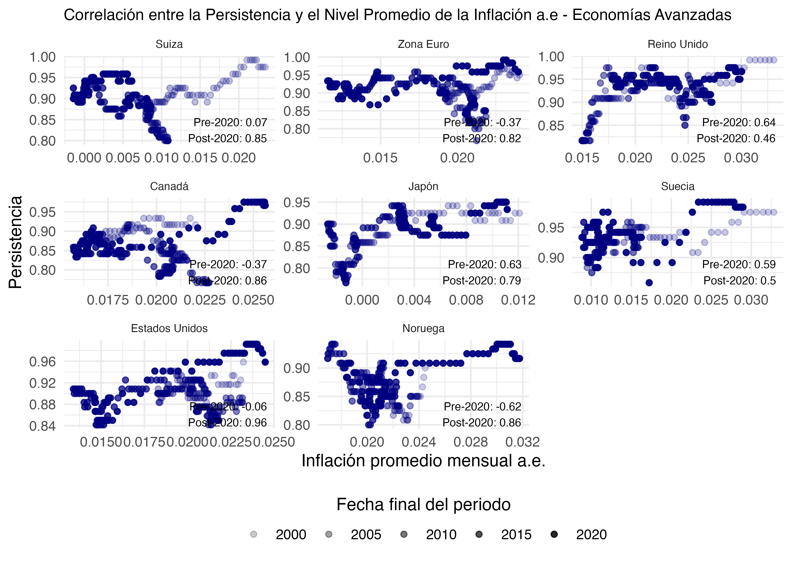

# Inflation persistence across 32 economies

Cross-country evidence on the relationship between average inflation and inflation persistence before and after the COVID-19 shock.



## Research question

Did the post-pandemic inflation episode increase the persistence of inflation, and did the change differ between advanced and emerging economies?

## Method

The analysis applies rolling 120-month windows to headline and core inflation series for 32 economies. For each window it estimates average inflation and a non-parametric persistence measure: the probability that inflation does not cross its mean. Correlations between the two measures are compared across the pre- and post-pandemic periods and reported by region.

## Main finding

The analysis documents a broad rise in the association between inflation and persistence after the pandemic. The shift is more pronounced in advanced economies, where inflation had generally remained below target before 2020; changes in many emerging economies are smaller relative to their historical persistence.

## Repository layout

```text
src/analysis.Rmd       Reproducible analysis
data/raw/              Input workbook
figures/               Selected published figures
results/               Space for regenerated tables and figures
```

## Reproduce

Install the R packages used in `src/analysis.Rmd`, then render it from the `src` directory with `rmarkdown::render("analysis.Rmd")`.

## Data and attribution

The input workbook compiles inflation series from central banks and national statistical offices. The implementation follows the non-parametric approach discussed in Banco de México's work on inflation persistence. Please cite the original statistical source for each series when reusing the data.

## Author

María Harfush. Derived from the empirical evidence in *Efectos de la política económica sobre la dinámica inflacionaria* (undergraduate thesis, UNAM).
